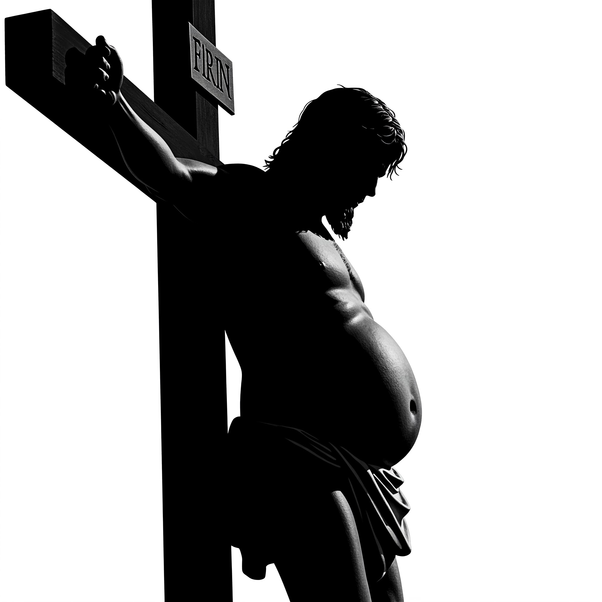
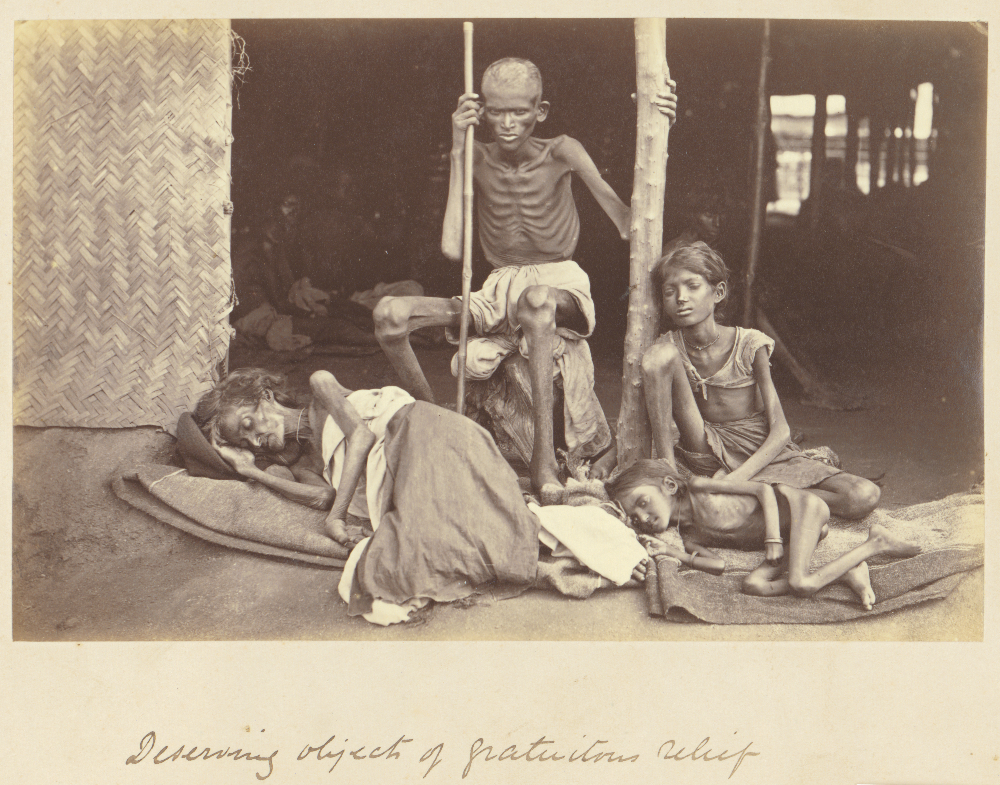

# Gluttony: the idolatry that almost no one wants to talk about.

> “Woe to you who are well-fed now, for you shall be hungry.” —
> Jesus[^1]

## Gluttony = Greed[^2]

Greed is taking what you do not need at the expense of others. It is a
general term that covers many kinds of selfishness, including many types
of self-indulgence and holding onto things that we do not need. Many
people acknowledge that greed is not good but few people acknowledge
that their own greed is bad. Even fewer realize that greed is a form of
idolatry. However, Paul taught this in Colossians 3:5: “Put to death
therefore your members which are on the earth: sexual immorality,
uncleanness, passion, evil desire and greediness[^3], **which is
idolatry**.” He said the same thing in Ephesians 5:5: “Know this for
sure, that no sexually immoral person, nor unclean person, nor
greedy[^4] man (**who is an idolater**), has any inheritance in the
Kingdom of Christ and God.” Many people who claim to be Christian treat
greed like it is, at worst, a minor thing. This is true even for many
people who consider certain other types of idolatry as something very
serious. For that reason, almost no churches today treat the sin of
greed as a serious thing that requires church discipline or even
correction (other than perhaps at ridiculous extremes that are not even
acceptable in parts of secular society). So it is not surprising that
most churches, at least where living in ease and luxury is the norm, are
full of greedy people. Such people often give some money or time to
others and, because of that, justify or ignore their other actions that
are greedy.

Gluttony is the greedy use of food and drink. Gluttony takes two basic
forms:

1.  overeating (or overdrinking where the drink contains calories),
    which if it lasts for long, always leads to the person who is
    overeating becoming too fat.
2.  eating overly expensive foods when cheaper food will serve the
    purpose of adequately nourishing our bodies.

Notice that neither of the above descriptions of gluttony are based the
idea that it is bad to enjoy food. The problem of gluttony is not that
we find food pleasurable, as God has given us this as a gift to enjoy.
The problem is when our pleasure becomes more important to us than the
priorities of God’s kingdom and when we lack the self-control not to
waste what God has given us.

While greed is not a topic most people want to spend much time
considering, gluttony is an even more taboo topic. Many people have been
taught to be very careful not to talk about the excess fat of others, as
though it was some innate quality of a person, like their skin colour or
their gender. This idea is based on either a great ignorance of human
biology or a very twisted view of human behaviour and sin. In modern
Western society, it has even been taken so far as to present fat people
as though they are victims. However, if we want to take Jesus and his
teaching seriously, this is not a topic we can avoid for fear of
offending people.

## Overeating = Waste

God made our bodies to need food both for energy and for the nutrients
required to build and maintain our bodies. Because God created us to
live in a world where we do not always have enough, he gave us the
ability to eat more food than we need and store some of the excess
energy as fat. This excess fat then allows us to have energy at times
when we do not eat enough to meet our needs. This is a beautiful gift
from God. It has undoubtedly saved the lives of countless people over
the history of humanity. However, for those of us who always have more
food available to us then we need, this ability to store fat creates the
opportunity for our small, healthy reserve of fat to grow into a large,
unhealthy reserve of fat, and to keep growing. Putting too much fat on
our bodies not only creates health problems but it is wasteful of the
limited resources we have. There are rare exceptions where we have
access for a short time to cheap or free food that will otherwise perish
and can not be shared. Eating more than we need in that context and then
using up the spare fat later will allow us to spend less time or money
on food and use that for something else instead. However, in most
situations where people eat enough extra that they start to become fat,
this is just a waste of food and either the time to grow that food or
the money to buy it. Carrying around extra fat also comes at a cost.
Many of the physical activities we do, including something as simple as
walking, require more energy for every extra kilogram of fat we have. As
well, even when we are sleeping, every extra kilogram of fat we have
requires some energy to maintain. That extra energy has to come from the
food we eat which means that extra weight we put on requires us to eat
more food than we would have to if we did not have that extra weight,
just to maintain our body weight. The fact that putting on unneeded fat
is wasteful is fairly obvious. However, the fact that maintaining that
extra fat, even without putting on any extra, is also wasteful is not
obvious to many people who have not thought carefully about this topic.

## Luxurious eating = Waste

Eating food that is unnecessarily expensive or costly to produce is also
wasteful. At extremes, like eating caviar or very expensive mushrooms or
other delicacies, it is more obvious to most people the waste involved
since so much money is being spent. However, many people who always live
with abundance give little thought to the fact that certain foods might
be more wasteful than others.

A healthy diet usually requires a variety of foods[^5] as we need a
variety of nutrients to sustain or bodies. This means that figuring out
what best to eat is not just a simple matter of finding the one cheapest
food and eating that. As well, depending on where we live, the cost of
producing or buying any given food may vary quite a bit. This complexity
creates an easy situation for us to ignore or excuse our gluttony.
However, for most people who live in a rich country, there is a lot that
can be easily and immediately done to simplify or decrease the cost of
our eating and drinking to save both time (in buying and preparing food)
and money. Both time and money (which for most of us are
interchangeable) are things that God has given us in limited quantities.
Both time and money can be used in various ways to advance the
priorities of Jesus’s mission here on earth. Therefore, it should be of
interest to all of us who are trying to love God with all his heart,
soul, mind and strength to find ways that we can avoid wasting time and
money so that we can invest more of those resources in the things that
God desires.

## The Root of the Problem

Gluttony and greed have selfishness at their root. Although ignorance
and carelessness can lead to unintentional wastefulness, the usual cause
behind the excessive or luxurious misuse of food that we call gluttony
is selfish, self-indulgence. Selfishness is the opposite of what Jesus
has taught and the opposite of the example he left us. We only know
about the short part of Jesus’s life that is recorded in the New
Testament. That description does not include much about what his body
looked like or what exactly he ate. However, we do have a clear enough
description of how Jesus lived and what he taught to know that the
accusations that he was a glutton[^6] were obviously just as false as
the accusations that he was a drunkard. We even have the record that he
at times was so busy serving others that he had no time to eat[^7]. This
was obviously no minor thing (such as just delaying his meal for an
hour) as some people close to him came to him and wanted to seize him
because they thought he was insane[^8]. Although at a later point, Jesus
took his disciples away from the crowd so that they could have a chance
to eat [^9], the whole tone of Jesus’s teaching and what we know of his
life show us that this was a man of great self-discipline and not
someone ruled by his taste-buds. This is so obvious that there is
probably not a single person who loves Jesus that would think the
following picture could be an accurate portrayal of him:

  

You may be offended that anyone would even make such a picture to
represent Jesus. If you are, ask yourself this: if it is offensive to
God to portray Jesus as fat, how could it be acceptable for his
disciples, who claim to be his body on earth, to be fat for any
significant length of time?

We know intuitively that Jesus was not fat, even without any clear
description of his body, because we know that Jesus was a
self-controlled man who was focused on the work off his father and not
on feasting and drinking. The simple logic of that reality cuts through
most of the excuses people make for the excess fat that comes from
gluttony.

We also know intuitively that Jesus was not pursuing expensive foods to
please his tastes. We do not have detailed descriptions of what he ate
but we do have some mention of him eating simple common food like bread,
fish, figs, honeycomb, and wine[^10].

Jesus’s whole life was a demonstration of the principle of delayed
gratification. The writer of Hebrews described it this way: “Therefore
let’s also, seeing we are surrounded by so great a cloud of witnesses,
lay aside every weight and the sin which so easily entangles us, and
let’s run with perseverance the race that is set before us, looking to
Jesus, the author and perfecter of faith, who for the joy that was set
before him endured the cross, despising its shame, and has sat down at
the right hand of the throne of God.”[^11]

Jesus was willing to forego what he wanted in the short term because he
saw the joy that was set before him. We see this clearly in his willing
submission to torture and death but this aspect of his behaviour did not
start at his arrest, torture and crucifixion. His behaviour at the end
of his life was just the logical expression of a principled life of
self-denial.

Notice from this passage in Hebrews that the things which we are to
throw aside in pursuing Jesus’s example are not just sin but also any
weight that could slow us down in the race we have to run. This is
obviously using the example of a physical race to speak about a
spiritual one. This should make it easy to see that time and resources
we devote to things that do not in any way help us in this race of
running after Christ are all things that should be set aside. Worldly
people understand this principle. That is why you never see any fat
Olympic runners. Fat runners don’t make it into the Olympics because
their extra weight slows them down and makes them unable to compete with
runners who were more self-disciplined in what they ate. That is also
why when you see a car race, whenever a car pulls over for repairs,
everything that is done is just focused on getting that car back into
the race in good working shape. No one is taking time to redo the paint,
wash the car, put in a great sound system, or change the air freshener.
When winning the race is at stake, even worldly, self-indulgent people
know what it takes to win and are willing to set aside their normal
self-indulgent habits.

The race we are in is of so much greater importance than who can run or
drive the fastest. We are in a race where our own souls and the souls of
others are at stake. Paul said this to the Corinthians: “Don’t you know
that those who run in a race all run, but one receives the prize? Run
like that, so that you may win. Every man who strives in the games
exercises self-control in all things. Now they do it to receive a
corruptible crown, but we an incorruptible. I therefore run like that,
not aimlessly. I fight like that, not beating the air, but I beat my
body and bring it into submission, lest by any means, after I have
preached to others, I myself should be disqualified.”[^12]

The self-control and self-discipline that we see in competitive athletes
is the same thing we see in Paul and the same thing we need to see in
ourselves if we, like Paul, do not want to be disqualified from this
race we need to run. Although the types of things we need to do to train
for this race we are in are not the same as Olympic runners, we still
need the discipline to put away from us things that will only slow us
down in our pursuit of Jesus and his mission. That obviously includes
many different types of things we need to get rid of or cut back on, but
overeating and overspending on food are certainly two of those things
that need to be sacrificed for the sake of our mission here on earth. I
am very certain that no one is going to arrive at judgment day and wish
they just had that one extra dainty or just one more helping of food.
However, countless people are going to stand with everything laid bare
before the judge and wish that their selfish overindulgence was not so
obvious, both in the appearance of their bodies and the record of their
actions.

Just as an athlete training to compete is not helped by ignoring the
issue of self-control in eating and just as a good coach of a
competitive athlete is not going to overlook or keep quiet if that
athlete is getting fatter, we need to have the courage to honestly look
at and speak about this issue.

## Excuses, excuses, excuses

It is not comfortable to take an honest look at our bodies and
acknowledge that we are too fat. Neither is it comfortable to admit we
have been wasting God’s money on buying needlessly expensive food. For
that reason, many people have come up with excuses to justify themselves
or their friends and family. In many cases these excuses are simply a
reflection of a heart that does not want to submit to the discipline
required to live under the law of Christ or what is required to follow
his example. However, in some cases genuine ignorance or
misunderstanding may contribute to these excuses and so it may be worth
addressing at least some of them.

## “How much is too much?”

One of the most common types of excuses that people make to justify
obesity is just to deny that it even exists or claim that it only exists
at such extremes that almost no one is obese. This is common in
societies where the majority of people are overweight. Some of this is a
natural consequence of being surrounded by excess food and therefore
excess weight. When you get used to seeing something all the time, it
seems normal to you. People who grow up in a society where men wear
nothing more than loin-cloths do not think of a man with a loin-cloth as
naked and probably do not even think of it as immodest. However, put
that same man into a very modest society and everyone will be shocked
and he undoubtedly too will feel uncomfortable. In the same way, if most
of the people you know are overweight, there is a good chance you may
not notice it. This raises the question of how much fat is too much.
Although there is no perfectly precise answer to this question, that
does not mean that we can pretend that there is no way to evaluate who
is overweight and who is not.

Obesity and an overly rich diet are leading causes of health problems in
rich countries all over the world. A lot of research has gone into this
topic for that reason. A very simple way to objectively measure this is
called body mass index (BMI). BMI is a way of comparing your height to
your weight in a way that tries to give a rough idea of if your weight
falls within the normal range for your height. I encourage you as an
exercise in honesty to calculate your BMI if you do not already know it.
If your BMI falls above the normal range, I encourage you to make an
honest evaluation of why this is and what you need to do to fix it.

If you would like more information about this, some basic information
with how to calculate your BMI and an online calculator are available
here: <https://www.cdc.gov/bmi/about/index.html>

## “I’m just a big person.”

Some people suggest that their obesity is just a result of being a “big
person” or being “big boned”. Although there is some truth to the idea
that there is variation from one person to the next as to how much they
will weigh even if they are the same height and the same percentage of
body fat, this is usually wildly exaggerated in the excuses people make
to try to declare themselves innocent in this area. Normal BMI ranges
are made to accommodate a range of body types for this reason and if you
are much outside of the normal BMI range, there is a very good chance it
is because you have overeaten and have too much fat on your body. Common
exceptions to this are people who are unusually muscular. However, the
amount of muscle that you need to fall significantly outside the normal
BMI range without much excess fat is usually only possible to obtain
with significant muscle-building exercise. The vanity that usually
drives that kind of body-building activity is also a serious sin and
needs to be repented of as much as gluttony does. Unless you are someone
who spends a large amount of your time doing heavy physical labour then
you should be slow to assume that an abnormally high BMI is caused by
being unusually muscular.

## “I’m just retaining water.”

Another common excuse for being overweight is water-retention. However,
in normal, healthy, non-pregnant people, the amount of water that you
retain does not vary significantly enough to make a person with a normal
amount of body fat look significantly overweight. There are medical
conditions that cause people to retain large amounts of water but they
are not common and they usually cause such serious complications that
they are obviously not just normal variation[^13]. In people who do not
have one of these serious medical conditions, the most common cause of
significant water retention is having too much fat. Pregnancy can cause
some reasonable amount of lower-limb water retention too but by the
stage of pregnancy that this happens, it is usually very obvious why. In
more than twenty years working as and training to be a medical doctor, I
have not yet seen a person who had normal or low amounts of body fat but
was retaining significant enough amounts of water to look overweight who
did not have a serious medical problem. If you have any serious doubt
about how much of your size is due to water retention, any competent
medical doctor should be able to help you distinguish this.

## “I can’t lose weight, no matter how little I eat.”

Some people claim that being too fat has nothing to do with what or how
much they eat. Some people will claim that their genetics or hormones
prevent them from loosing weight. When I was in my medical training, I
worked with a rural family doctor who had an unusually insightful
comment on this. He told me that when he first started in his rural
medical practice he had patients who insisted that they ate very little
but still were unable to lose weight. He initially tried to be
sympathetic to these patients but over the years he would run into some
of these people in the small town he worked in with a soda and bag of
chips in their hands and he started to realize what was going on. He
began telling people who gave this story that there were no fat people
taken out of the Nazi concentration camps. It is a well established fact
that when people are put into situations where they do not have enough
to eat that every one of them loses weight. This simple fact exposes the
foolishness of excuses that try to pretend that people can get fat
without eating too much or can remain fat no matter how little they eat.
I want to present a couple of pictures that illustrate this point. The
first is a picture of a group of prisoners who were freed from the
Ebensee Nazi concentration camp in 1945.

  

You will notice that in spite of the fact that the people in this
picture would have had varied genetics and probably different levels of
hormones, they all look very underweight. The second picture is of a
group of people who were suffering under one of the horrible famines
that happened in India in the 1800s under British rule.

  

If pictures like this are not enough to convince you that everyone
inevitably gets thinner when their food intake drops to a certain point,
then you can seek to enrol as many people as you can in a simple
experiment. Try a 40 day fast of nothing but water. Each person can
weigh themselves before and after the 40 days and try to see if you can
find anyone whose weight does not drop significantly. If you find
someone whose weight did not decrease and you are sure he or she is not
lying, you can sign them up for a supervised medical study. If you could
find something like that, it could be the solution to world hunger!
However, I think you know what would happen in such an experiment.

## “I know someone who eats too much but never gets fat.”

This, like the previous excuse, is based on a misunderstanding of human
biology that presumes that the amount of food we eat and the amount fat
we put on are somehow not closely or consistently related. However, this
is not the case. The person who consistently eats more calories than he
needs will put on fat, unless he is doing something to prevent that like
vomiting the food up. This is the basis of the eating disorder commonly
called bulimia where people intentionally eat more than they need and
then intentionally vomit up the food in order to avoid getting fat (or
in some cases to stay thinner than they need to be). In rich societies
where this practice is more common, this is usually understood to be a
disorder of the mind. It is interesting that people who just as
compulsively eat as the bulimic but retain the food and accept the
resulting obesity are usually not considered to have a disorder of the
mind. Somehow worldly society seems to consider intentionally vomiting
up food to be wasteful and dysfunctional without carefully considering
that overeating to the point of obesity is similarly wasteful and
dysfunctional.

In my years working as a medical doctor, I have taken care of many
patients in the hospital who were admitted to hospital either solely as
a result of their obesity or where their overeating and obesity were a
significant contributing factor to why they were admitted to hospital. I
have yet to take care of a patient in hospital who was there because
they overate and then intentionally vomited up their food. Undoubtedly
this is, in part, because bulimia is much less common than overeating to
the point of obesity. However, I suspect that the fact that bulimia, if
not used to induce unhealthy weight loss is actually less damaging to
the body then overeating to the point of obesity. Of course, it is still
a sinful, wasteful activity but I make this point simply to discourage
the kind of careless thinking that excuses common patterns of lack of
self-control but criticizes uncommon ones.

Returning back to the original point, the person who is not gaining
weight and is not bulimic is, in fact, not eating too much. They may at
one meal or for one day, eat more than they need at that moment but the
fact that they are not noticeably putting on weight shows that they are
not overeating overall. Some people may need to eat more food than other
people in order to maintain a healthy weight. Alternatively, some people
may eat more than they need for a time and then their lack of hunger may
cause them to reduce their eating and use up some of the excess fat they
put on.

## “Weight loss is just a body image thing.”

It is true that many people in wealthy countries seek to lose fat in
order to conform to their society’s ideas about beauty (just as it is
true that there are people in poor countries that seek to put on excess
fat in order to conform to their society’s ideas of beauty). However,
weight loss is not just about body image. As stated earlier, maintaining
extra fat is a waste of food as it requires more calories than it does
to maintain a healthy weight. Beyond that, being overweight has many
physical consequences that make us potentially less useful to our
mission here on earth. This is so well understood in our day that I can
only presume that people using this kind of excuse are either largely
unaware of the world around them or just making unreasonable excuses to
try not to face the reality of the sin of gluttony. This was already
understood at least in the second century. We can see that from the
following quote from what was probably the most popular early Christian
writing outside the New Testament, often referred to as *The Shepherd of
Hermas* or *The Shepherd*. This writing records a series of visions that
a man named Hermas from Rome had in the late first century or early
second century. One of those visions was given to Hermas by an old lady
sent by God to show him the building of a large white tower. This tower
represented the Christian assembly being built and this is part of the
explanation of that tower vision:

> “Listen to me, children, by the mercy of the Lord, who fed you
> righteousness drop by drop, I nourished you in great sincerity and
> innocence and reverence in order that you might be righteous and
> purified from all evil and perversity. But you do not wish to cease
> from your evil. Now then listen to me and be at peace among
> yourselves, and be concerned for one another and help one another, and
> do not take the creation of God for yourselves alone, but share with
> those also who are in need. For by eating too much some are bringing
> on themselves illness in the flesh and are injuring their flesh; and
> the flesh of those who do not have food to eat is injured because
> there is not sufficient food and their body is wasting away. So this
> lack of community spirit is harmful to you who have and do not share
> with the needy. Consider the judgment which is to come. So let those
> who have more seek out those who are hungry until such a time as the
> tower is finished. For after the tower is finished you will wish to do
> good, but you will not have the opportunity. So you who rejoice in
> your riches see to it that the needy never groan and their groaning go
> up to the Lord, and you be shut outside the door of the tower with
> your goods.[^14]

The early Christians could have easily understood from this, if they did
not know it already, that overeating could cause health problems. People
today who have access to so much knowledge of human biology and medicine
have no excuse for ignoring this important aspect of why gluttony is a
major problem.

## “Poor people can not afford healthy food and therefore get fat from unhealthy food.”

This excuse is so ridiculous that I would not even mention it if it was
not so common, at least in rich countries (not surprisingly, I have
never heard this idea in any of the poor countries I have been in). If
it were reality that poor people couldn’t help getting fat because they
could not afford more expensive food, we should not see so many
underweight people in poor countries. Not only that but even if it was
true that cheaper foods caused people to put on weight more easily than
more expensive foods, people eating those cheaper foods can exercise
self-control and eat less of those foods until they stop putting on
extra fat. It should be obvious to anyone who spends much time thinking
about it that someone who has enough excess food to be significantly
fat, is not really that poor. For thousands of years, fatness has been a
well recognized indicator of being rich, not of being poor. That is why
being fat is a status symbol in many poor societies.

## “God made every food to be enjoyed.”

There is certainly truth behind this excuse (although I would challenge
anyone who uses this excuse towards careful self-reflection about
whether they really seek to enjoy everything that God made that is
edible[^15]). However, the question of what is gluttony has nothing to
do with certain foods being inherently wrong but of whether we are being
selfish in our use of food.

Imagine for a moment that you live in a poor area of south-east Asia.
Rice is the staple grain and widely and cheaply available. However, some
of your neighbours are poor enough that they do not always have enough
rice to eat and therefore some of them are dangerously underweight and
weak enough they have difficulty working the manual labour they must
work to survive. Imagine you grew up in a country where wheat was the
major staple grain and you really prefer the taste of wheat to rice.
Wheat flour is available to buy locally but is four times the price of
rice because it has to be imported from far away. The question you face
is if you will pay that much more for food based on your preference
rather than choosing the cheaper option and having more to help your
neighbours who do not have enough to eat. This has nothing to do with
whether wheat is a forbidden food but has everything to do with whether
your choice of foods will be based primarily on your love for your
neighbours or based primarily on the desires of your flesh.

Another thing to consider with such an excuse is that just because God
gave us something to enjoy does not mean that we do not need the
self-control to keep our desires in check. God has given sexual pleasure
as a gift to us. However, that does not mean that he does not expect
considerable self-control in our use of this gift. We should all be able
to recognize that even in the context of marriage, if our desire for
pleasure is allowed to direct our decisions above concern for others
that we are not making proper use of the gift that God has given us.

## “I’m too unwell to exercise and therefore can’t lose weight.”

Although it is true that the amount of physical activity is a factor in
how much fat we put on or take off of our bodies, this excuse is based
on a fundamental misunderstanding of human biology. The amount of energy
that our body uses in a day is a combination of a basic amount that our
body needs for cellular activity and whatever extra we need to perform
whatever physical activity we engage in. If we do no physical activity
in a day our body still needs energy to perform many basic functions. If
the food we consume in a day provides less energy than what our body
requires for its basic functions then our body will start to consume its
energy stores (which are primarily fat) and we will loose weight. This
is why very sick patients who are admitted to modern Intensive Care
Units can lie completely still in bed and even have the work of
breathing done by a machine and all reduce their amount of fat (and
muscle mass too if left long enough) if not feed enough artificially.

## Back to Jesus

As I quoted at the beginning of this article, Jesus said in Luke 6: “Woe
to you, you who are full now, for you will be hungry.” He also said:
“Blessed are you who hunger now, for you will be filled.” This alone
should be sufficient for anyone serious about following Jesus to very
carefully and soberly examine how we use food. However, Jesus taught a
number of general principles that have significant bearing on the topics
of greed and gluttony.

## Love your neighbour as yourself

When Jesus pointed back to the Old Testament command to love our
neighbours as ourselves he was teaching a key principle of his kingdom,
something that is very near to the heart of God. It should be obvious to
us if we spend even a little bit of time thinking about it that if we
choose to feed ourselves with more food or more richly than we need
while our neighbour is hungry that we are not loving our neighbour as
ourselves. We as individuals can certainly not feed every hungry person
in the world but that should never give us the excuse that we can not
get rid of excessive consumption in order to make more available for
someone else.

Although Jesus was quoting the Levitical law when he quoted this
command, he was not just reminding people of an Old Testament standard
and leaving it at that. Much of Jesus’s teaching flushes out what it
looks like to love our neighbour and Jesus’s own example also shows this
very clearly. The Jews had the command but they did not fully understand
God’s heart behind it until God sent his own son to guide us to God’s
original intentional for his creation.

## Who is my neighbour?

Jesus was not the only person who understood the importance of the
command to love our neighbour as ourselves. A Jewish expert in the law,
when asked by Jesus to summarize the law, gave the following response:
“You shall love the Lord your God with all your heart, with all your
soul, with all your strength, and with all your mind; and your neighbour
as yourself.” Jesus response to him was this: “You have answered
correctly. Do this, and you will live.”[^16]

However, this expert in the law was more insightful than many today who
casually quote these two commands as though they were not really that
costly [^17]. Recognizing that to love your neighbour as yourself was
costly, this expert in the law tried to justify himself by asking Jesus
who his neighbour was. Presumably he was hoping Jesus would agree that
this command was limited in its scope just to those who were close to
him. Before you judge this man for his question, you should consider
that the original context in which this command was given does imply it
was something to be practised with fellow Israelites or possibly closer
family members and not necessarily a universal principle of how to treat
all people. God had said through Moses, “You shall not take vengeance,
nor bear any grudge against **the children of your people**; but you
shall love your neighbour as yourself.”[^18]

Jesus responded to this man’s question with the famous story of the
Samaritan man who on a long journey discovered a Jewish man by the side
of the road who had been robbed and beaten and left for dead. This
Samaritan did what he could, at his own personal expense of time and
money, to save this Jewish man’s life. This Samaritan’s behaviour was
contrasted with two very religious Jewish men who chose not to risk
helping their fellow Jew. Then Jesus asked the question, “Now which of
these three do you think seemed to be a neighbour to him who fell among
the robbers?” The expert in the law gave the only answer he really
could: “He who showed mercy on him.” To this, Jesus replied, “Go and do
likewise.”

The intent of Jesus’s story is clear: whoever is in need is your
neighbour. In other words, everyone is your neighbour. This story is
sometimes used by people to argue that our neighbours are those that are
physically near to us, such as in this story where the Samaritan found
the Jewish man on the road he was travelling on. The intended
implication of this is that we are not responsible for those we can not
see. This is a very convenient interpretation for those who live in
countries so rich that there are few people who are truly poor, other
than by their own choice. However, imagine if in this story of the
Samaritan, that the Samaritan had heard before he ever started on this
road that there was a man who had been robbed and was dying on that
road. Imagine if he had decided to take a different route so that he
never had to see this injured Jewish man. If that had been the case,
would Jesus have used this story to answer the question about who is my
neighbour? Would people have repeated this story countless times over
the last two thousand years? I think it should be obvious with just a
little bit of thought that Jesus’s intent in telling this story was not
to place limits on who we are responsible for but to explode those
limits.

Like it or not, we live in a world where many people do not have enough
food or nutritious enough food to be healthy. Although we will not fix
that problem entirely, there are things we can do to help some of those
people. If we choose not to, it is not because we do not know those
people are out there. They may not live right where we do, but for those
of you living in rich countries, that is almost always because you
choose not to go where they are and they are prevented, either by
circumstances or by the government of the country you live in, from
getting to where you are.

Do not fool yourself into thinking that just because you are surrounded
by fat, overindulgent people that Jesus will think you have been
faithful to this principle to love your neighbour as yourself, when you
imitate the selfishness of your close neighbours and ignore the needs of
your far ones.

## Do to others as you would have them do to you

In the the *Sermon on the Mount*[^19], Jesus taught his disciples and
those listening that, “whatever you desire for men to do to you, you
shall also do to them; for this is the law and the prophets.”[^20] This
is a restatement of the same basic principle behind “love your neighbour
as yourself.” However, it can be helpful to use this way Jesus expressed
it to ponder how you would want others to treat you. Imagine if, rather
than having more food and money then you need, you were one of the many
people in the world having to go hungry some of the time simply for lack
of a way to get enough food consistently. Better than that, imagine that
you have children also and have to listen to them cry themselves to
sleep at night due to hunger or illness caused by inadequate nutrition.
Do you have any question how you would want others who had more than
enough to treat you? It is true that there are some in the world whose
laziness or foolishness may be best treated with a period of hunger.
However, that is not true for everyone and there are enough blind,
crippled, sick, widowed, and orphaned people in the world who simply can
not help the fact that they suffer and, all too often, die from lack of
nutrition. We may not think of those people as we are eating our
over-abundant meals because we do not have to hear their cries. However,
Jesus does. He has to listen both to the zealous munching and sipping of
gluttons and the pathetic cries of starving children, **at the same
time**. I can assure you he is not happy with that and he is not going
to tolerate it for much longer.

I am, for the sake of simplicity of this article, restricting my
discussion to the physical needs of others, and primarily their lack of
food. However, when you consider the immense spiritual needs of others
and how our wasteful use of time and money is also a hindrance to us
meeting those spiritual needs, this exercise of pondering what we would
want others to do for us if we were in their situation should cause much
fear and trembling in us as we think of the implications.

## Deny yourself

Getting to the root of the problem that creates gluttony requires
addressing two things. First, we need to address the lack of love that
causes us to be comfortable with over-indulging while someone else goes
without. Second, we need to self-control to actually change our
behaviour. If we are thoughtful observers of humanity we can see that
people are often capable of amazing feats if they have the motivation.
People who have been blind and deaf from childhood can learn to speak;
people can make incredible recoveries from crippling injuries or
strokes; people can perform amazing physical feats and acts of
endurance. All of this can be done without the spirit of God helping
them.

These people do these things usually for their own selfish interests but
we are called to acts of greatness out of love for others. It is for
that reason that we need Jesus’s spirit in us. It is perhaps not
coincidental that when Paul listed the fruits of the spirit, that he
started with love and ended with self-control.

Self-control is another key principle of Jesus’s kingdom teaching. He
taught his disciples that if they wanted to come after him, they needed
deny themselves, take up their own cross and follow him[^21]. The
self-denial that Jesus calls us to takes many forms but if we can not
deny the desires of our stomach and taste-buds in order to be more
useful to Jesus and his mission of love, then we are are fooling
ourselves if we think we are going to go where Jesus went.

It is almost certainly not a coincidence that the very next thing Jesus
said in the *Sermon on the Mount* after saying that we should do to
others what we what them to do for us is this: “Enter in by the narrow
gate; for the gate is wide and the way is broad that leads to
destruction, and there are many who enter in by it. How narrow is the
gate and the way is restricted that leads to life! There are few who
find it.”[^22]

The way of love that Jesus walked is a narrow and difficult way because
it requires self-denial at a level that few people are willing to seek.
For many people, their excess fat and “necessary” dainties will prevent
their entry through that narrow gate that Jesus calls us through.

## Whoever loves his life will lose it

Another key kingdom principle that Jesus gave, and one of very few
things that Jesus taught that all four of his biographers recorded, is
the principle that “whoever desires to save his life will lose it, and
whoever will lose his life for my sake will find it.”[^23] John records
this teaching of Jesus a little differently than Matthew, Mark and Luke:
“He who loves his life will lose it. He who hates his life in this world
will keep it to eternal life.”[^24]

Jesus offers us a choice between having our best life now and loosing
everything later or giving up the life we want now in order to get
eternal life. Countless people have been fooled into thinking they can
try to get what they want now and have a life of blessing with God for
eternity. There are few ways that more graphically illustrate this
deception than fat or otherwise gluttonous “Christians” in a world of
hunger.

## The new command

If you are tempted to think that John was some sort of unreasonable
ascetic for recording Jesus as saying “he who loves his life will lose
it” and “he who hates his life in this world will keep it to eternal
life”, do not forget the new command that Jesus gave his disciples and
that became the central theme of John’s teaching:

> “A new commandment I give to you, that you love one another. Just as I
> have loved you, you also love one another.”[^25]

In case you have not noticed, the command to love one another is not a
new command. So what makes Jesus’s new command *new*? It is that he does
not leave it at that. He tells his disciples to love one another **as he
had loved them**, which is an amazingly high calling.

Jesus and later his disciples were not preaching or living some type of
brutal asceticism that just seeks to stomp out all enjoyment. Rather
Jesus is calling us to a love that is so great that my wants always take
a back seat to my neighbour’s needs. If that love and the necessary cost
of it are not of interest to you then have a choice not to seek to live
by these principles. However, do not fool yourself into thinking that
you are following Jesus if you have not dealt with the sin of gluttony
in your life.

## Keep yourself from idols

As with all sin, we need to start our fight against the sin of gluttony
by getting it out of our own lives. However, there is a need for this
not just to be a private, personal matter. Sin has far reaching
consequences beyond just our personal lives. There is a need for honest
and frank conversation about this topic in our local assemblies. Where
that results in sincere repentance and change and people forsake their
gluttony, we can be thankful. Where it does not we need to lovingly
exclude unrepentant sinners from our midst as Paul taught the
Corinthians[^26]. It is with good reason that Paul taught the
Corinthians to not even eat with anyone who is called a brother and is
greedy. It is also with good reason that Paul reminded them that a
little yeast leavens the whole lump.

If we trust Paul is correct that greed is idolatry, we need to be sure
to remove this sin from within our midst with the same seriousness as we
would other forms of idolatry. We can not afford to give sins that the
scripture says will prevent someone from inheriting God’s kingdom[^27]
just a wink or a shrug. It is easy for us to be very hard on sins that
disgust us and very lax with sins that attract us but we can not afford
to tolerate this kind of hypocrisy. We can also not afford to tolerate
the sins in people we love more than the sin of strangers. This
hypocrisy is the sin of the Pharisees that Jesus warned his disciples
about[^28] that allowed the Pharisees to create such a nice looking but
utterly rotten religion. We need to combine the great love that Jesus
had for others with his great hatred for sin, driven and motivated by
the love and fear of God and empowered by the Holy Spirit, or else we
will just be a part of one of countless man-made religions that have
arisen over the centuries as counterfeits of the religion that Jesus
brought down from his father.

> “Little children, keep yourselves from idols.” — John[^29]

[^1]: Luke 6:25

[^2]: Technically, this should be gluttony ⊂ greed, as gluttony is a
    subset of greed.

[^3]: also translated covetousness

[^4]: also translated covetous

[^5]: Exclusively breast-fed infants for a few months before they start
    to eat solid food are an obvious exception.

[^6]: Matthew 11:19 & Luke 7:34.

[^7]: Mark 3:20

[^8]: Mark 3:21

[^9]: Mark 6:31

[^10]: In Jesus’s society, wine probably referred both to fresh grape
    juice and naturally fermented grape juice. It was not just an
    expensive luxury drink like it is for so many today. It was the only
    way they had to preserve their large grape harvests in the days
    before refrigeration. It also served a practical purpose for them:
    when they mixed wine with their water the alcohol in the wine served
    as a disinfectant to kill some of the germs in the water that might
    have otherwise caused sickness.

[^11]: Hebrews 12:1-2

[^12]: I Corinthians 9:24-27

[^13]: examples of this include heart failure, liver failure, some types
    of kidney failure and some types of cancer

[^14]: *The Shepherd of Hermas*, Vision 3, chapter 9, verses 1-6 (also
    known by an alternative numbering system: 17.1-6)

[^15]: God made many foods that people do not always enjoy that are
    still useful. When people say that every food is given by God for
    them to enjoy, what they really mean is that they want to enjoy
    whatever they enjoy without much consideration for what makes most
    sense for other people or other considerations than their taste.

[^16]: Luke 10:25-37

[^17]: When people are trying to minimize the extreme nature of these
    two commands, they often just quote them as 1. love God, and 2. love
    your neighbour and leave out the additional phrases that make these
    commands so frighteningly costly

[^18]: Leviticus 19:18

[^19]: Matthew 5-7

[^20]: Matthew 7:12

[^21]: Matthew 16:24, Mark 8:34, and Luke 9:23

[^22]: Matthew 7:13-14

[^23]: Matthew 16:25, Mark 8:35 and Luke 9:24

[^24]: John 12:25

[^25]: John 13:34

[^26]: 1 Corinthians 5

[^27]: 1 Corinthians 6:9-10

[^28]: Luke 12:1

[^29]: 1 John 5:21
